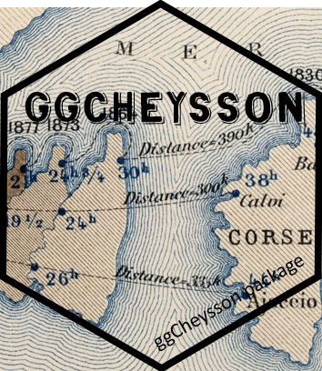
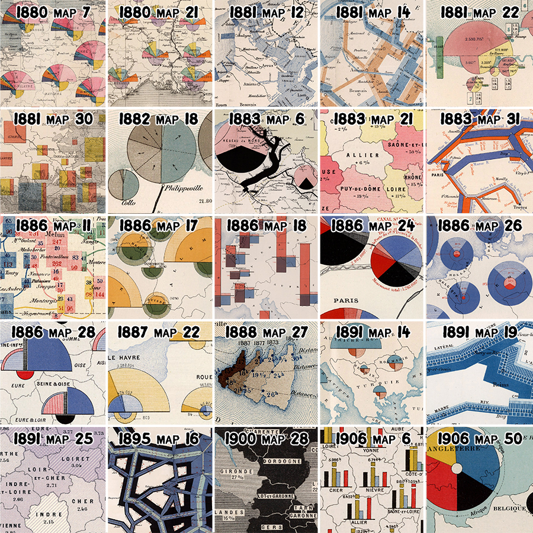
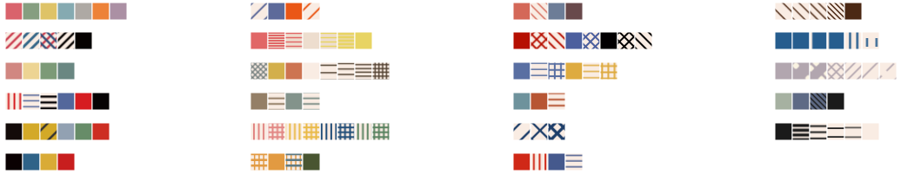
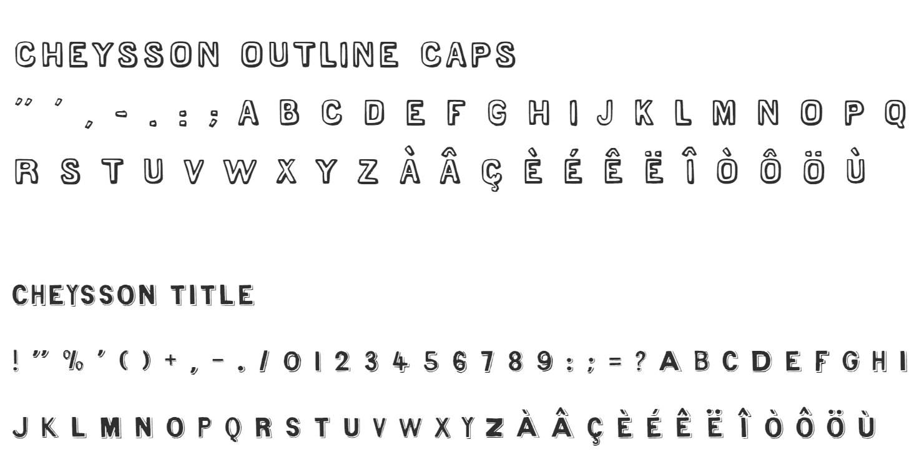
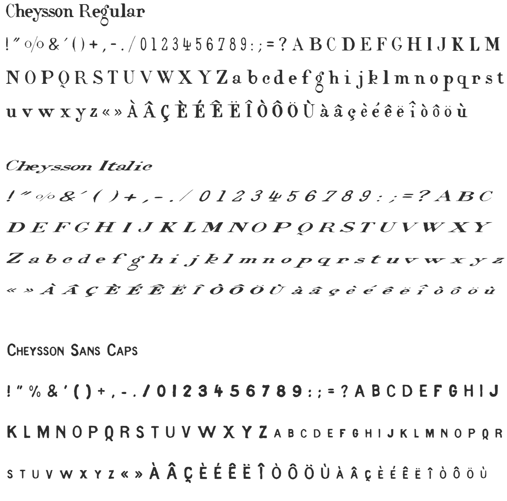
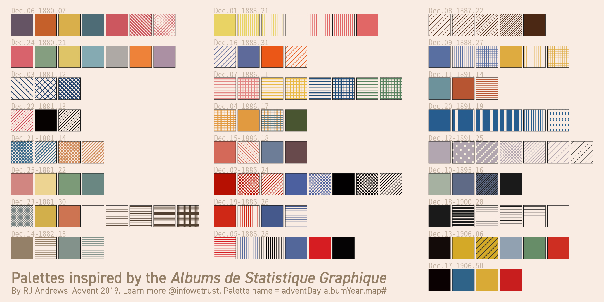

<!-- README.md is generated from README.Rmd. Please edit that file -->

```{r setup, include=FALSE}
knitr::opts_chunk$set(
  collapse = TRUE,
  comment = "#>",
  fig.path = "man/figures/README-",
  out.width = "100%",
  message = FALSE,
  warning = FALSE,
  error = FALSE
)
```

<!-- badges: start -->
[](https://cran.r-project.org/package=ggCheysson)
[](https://friendly.r-universe.dev/ggCheysson)
[](https://github.com/friendly/ggCheysson)
[](https://friendly.github.io/ggCheysson/)
[](https://lifecycle.r-lib.org/articles/stages.html#experimental)
<!-- badges: end -->

# ggCheysson  
Version `r getNamespaceVersion("ggCheysson")`; documentation built `r Sys.Date()`

The `ggCheysson` package brings the graphical styles of the _Albums de Statistique Graphique_ to R and ggplot2. 

The _Albums_ were produced by the Ministry of Public Works in France under the direction of [Émile Cheysson](https://en.wikipedia.org/wiki/%C3%89mile_Cheysson) from 1879-1897. They represent the "pinnacle of the Golden Age of Statistical Graphics"
(Friendly, 2008) for their innovation in visualization techniques, graphic design and
beauty.

The package is based on work by: 

* David Rumsey Map Collection: Complete digitized _Albums de Statistique Graphique_
  [View collection](https://www.davidrumsey.com/luna/servlet/view/search?q=album+de+statistique)
* RJ Andrews: [Classic Map Color Design](https://infowetrust.com/project/album-colors) | [GitHub](https://github.com/infowetrust/albumcolors)
* Tom Shanley: Observable implementation
  [Cheysson Color Palettes](https://web.archive.org/web/20210130125506/https://observablehq.com/@tomshanley/cheysson-color-palettes)
* Kenneth Fields: Hand-drawn font family creation
  [The style of Émile Cheysson](https://www.esri.com/arcgis-blog/products/arcgis-pro/mapping/the-style-of-emile-cheysson/)

## 🏛️ Historical Context

The _Albums de Statistique Graphique_ were published annually by France's Ministry of Public Works, showcasing infrastructure statistics through innovative visualizations. Under Émile Cheysson's direction, these albums combined:

- Sophisticated use of color to represent quantitative variables
- Hatching patterns to differentiate categories and show density
- Hand-lettered text with distinctive character
- Clear hierarchical organization of information

This package preserves these design elements for modern statistical graphics. Perhaps more interesting is the historical motivation that led to this project by me and the others mentioned above. Émile Cheysson and his draftspeople at the Ministry of Public Works drew all these plates
by hand. 

* Did they have an "in-house" style guide?
* How would graphic designers of today approach this task?


## 📂 Installation

Install the development version from GitHub or R-universe:

``` r
# install.packages("remotes")
remotes::install_github("friendly/ggCheysson")

# or, from R-universe
install.packages("ggCheysson", repos = c("https://friendly.r-universe.dev"))
```

### Suggested Dependencies

For full functionality, install these packages:

``` r
install.packages(c("ggpattern", "systemfonts"))
```

## ✨ Features

This package provides a complete aesthetic system for creating visualizations in Cheysson's distinctive style:

### 🎨 Color Palettes
- **25 authentic color palettes** extracted from the original Albums
- Sequential, diverging, grouped, and categorical palette types
- Named by album year and plate number (e.g., `1880_07`, `1881_12`)
- Compatible with standard ggplot2 color scales

### 📐 Hatching Patterns
- **134 pattern specifications** including solid fills, stripes, and crosshatching
- Line angles (0°, 45°, 90°, 135°) matching historical diagrams
- Variable densities and line widths
- Full integration with [ggpattern](https://coolbutuseless.github.io/package/ggpattern/)

### ✍️ Authentic Fonts
- **5 hand-drawn font families** replicating Cheysson's lettering style
- Regular, Italic, Sans Caps, Outline Caps, and Title variants
- Automatic loading and integration with ggplot2 themes
- Created by Kenneth Fields for historical accuracy

### 🎭 Complete Themes
- `theme_cheysson()` - Full period-appropriate theme
- `theme_cheysson_minimal()` - Minimal grid variant
- `theme_cheysson_map()` - Optimized for cartographic work

These were derived by RJ Andrews from a collection of 25 thematic maps across the span of years in which the _Albums_ were produced, shown below.

<center>

</center>

From these, he abstracted the following combinations of color and pattern he thought characterized these maps:

<center>

</center>

### New here

In the development version (1.2.0), `scale_cheysson()` (experimental) applies Cheysson's
actual *designed* color-pattern pairings in a single call. Each element of a palette is a
*swatch*, a `ggpattern` pattern that draws its fill color, hatch type, line colors, angle and
line spacing together, so a plot needs only `aes(pattern = x)` and one scale (see the examples
below, and `vignette("combining-colors-patterns")`). The individual pattern scales,
`scale_pattern_type_cheysson()` and the rest, remain for control over each property.


## 🚀 Quick Start

Here are a few examples to get you started.

### Basic Color Palette
Use the color palette of the 1881 Album, plate 4

```{r basic-palette, fig.height=4, fig.width=6, fig.alt="Scatterplot of iris sepal width against sepal length, with points colored by species in the muted rose, pale yellow and sage green of palette 1881_22"}
library(ggplot2)
library(ggCheysson)

ggplot(iris, aes(Sepal.Length, Sepal.Width, color = Species)) +
  geom_point(size = 3) +
  scale_color_cheysson("1881_22") +
  labs(title = "Iris Dataset") +
  theme_minimal()
```

### With Fonts and Theme

```{r with-fonts, fig.height=5, fig.width=7, fig.alt="Scatterplot of mpg against car weight from mtcars, colored by number of cylinders in slate blue, brown and orange from palette 1883_31, drawn with theme_cheysson: a bold outlined capital title, a serif subtitle and small-capital axis titles"}
# Load Cheysson fonts (once per session)
load_cheysson_fonts(method = "showtext")
# Enable showtext for rendering
showtext::showtext_auto()

p1 <- ggplot(mtcars, aes(wt, mpg, color = factor(cyl))) +
  geom_point(size = 3) +
  scale_color_cheysson("1883_31") +
  labs(
    title = "Automobile Efficiency",
    subtitle = "Weight vs Fuel Economy",
    x = "Weight (1000 lbs)",
    y = "Miles per Gallon"
  )

p1 + theme_cheysson()
```

### Scaling with `base_size`

Like other ggplot2 themes, `theme_cheysson()` takes a `base_size` for larger
output (slides, posters). Title and axis-title text (set in the decorative
`CheyssonTitle`/`CheyssonSansCaps` fonts) is corrected to scale at the same
rate as the rest of the theme, rather than reading undersized as `base_size`
grows:

```{r base-size-14, fig.height=5, fig.width=7, fig.alt="The same mtcars scatterplot with theme_cheysson(base_size = 14): title, subtitle, axis and legend text are all larger, in proportion"}
p1 + theme_cheysson(base_size = 14)
```

```{r base-size-16, fig.height=5, fig.width=7, fig.alt="The same mtcars scatterplot with theme_cheysson(base_size = 16): the text is larger still, with the title fonts scaled in step with the rest"}
p1 + theme_cheysson(base_size = 16)
```

### Complete Cheysson Aesthetic (Colors + Patterns + Fonts)

```{r complete-aesthetic, fig.height=5, fig.width=7, fig.alt="Bar chart of four categories, A to D, in theme_cheysson, each bar hatched with a swatch from palette 1883_30: red diagonal stripes, blue diagonal stripes, red and blue crosshatching, and black diagonal stripes"}
library(ggpattern)

data <- data.frame(
  category = LETTERS[1:4],
  value = c(15, 23, 18, 20)
)

# One scale applies the palette's colors, hatch types, angles and spacings together
ggplot(data, aes(category, value, pattern = category)) +
  geom_col_pattern(color = "black") +
  scale_cheysson("1883_30") +
  labs(
    title = "Statistical Comparison",
    x = "Category",
    y = "Value"
  ) +
  theme_cheysson() +
  theme(legend.position = "none")
```

## 🌈 Available Palettes

`cheysson_palettes` provides 25 named color palettes, each with its type
(sequential, diverging, grouped, or category), the album year and plate
number it was extracted from, and its hex color codes.

<details>
<summary> <span style="color: blue;"> Click to show/hide the list of all palettes </span> </summary>

```{r list-palettes, message=FALSE}
library(ggCheysson)

# List all palettes
list_cheysson_pals()

# List by type
list_cheysson_pals("sequential")
```

</details>

```{r palette-colors}
# View palette colors
cheysson_pal("1880_21")
```

### Visualizing Palettes

Use `show_palette()` to display a palette with color swatches and hex codes:

```{r show-palette, fig.height=2, fig.width=8, fig.alt="show_palette() display of palette 1895_16: a header giving its type (sequential), album 1895 and plate 16, above three color rectangles, sage grey, slate blue and near-black, each labeled with its hex code"}
# Display a single palette with metadata
show_palette("1895_16")
```

```{r show-palette-multi, fig.height=6, fig.width=8, fig.alt="show_palettes() display of three palettes stacked vertically, each with a header and labeled color rectangles: category palette 1880_21 with 7 colors, category palette 1906_06 with 6 colors, and grouped palette 1881_30 with 5 colors"}
# Display multiple palettes at once
show_palettes(c("1880_21", "1906_06", "1881_30"))
```

```{r show-palette-grid, fig.height=4, fig.width=10, fig.alt="show_palettes() display in a 2 by 2 grid, one palette of each type: category 1880_21 (7 colors), sequential 1895_16 (3 colors), diverging 1883_21 (red, cream, yellow) and grouped 1881_30 (5 colors)"}
# One palette of each type in a 2x2 grid: category, sequential, diverging, grouped
show_palettes(c("1880_21", "1895_16", "1883_21", "1881_30"), ncol = 2)
```

Some palettes, such as the sequential `1881_12`, have only one color: Cheysson made the steps
with hatching of increasing density rather than with shades. Their swatches here show a single
color; use `cheysson_pattern("1881_12")` to get the full palette (see Pattern Support, below).

```{r show-palette-type, fig.height=8, fig.width=8, eval=FALSE}
# Display all palettes of a specific type
show_palettes("category")
```

Palette types:

- **Sequential** (7 palettes): For ordered quantitative data
- **Diverging** (2 palettes): For data with neutral midpoint
- **Grouped** (10 palettes): For comparing related groups
- **Category** (6 palettes): For categorical data

## 📐 Pattern Support

With ggpattern, recreate the distinctive hatching styles - each palette pairs colors with
historically accurate patterns (solid fills, stripes, crosshatching):

```{r patterns, message=FALSE}
library(ggpattern)

# List available pattern palettes
head(list_cheysson_patterns())

# Each element of a palette is a bundle of properties
patterns <- cheysson_pattern("1886_24")
str(patterns[[2]])
```

```{r pattern-swatches, fig.height=2, fig.width=8, fig.alt="The eight swatches of palette 1886_24 side by side: solid red, red crosshatching, red diagonal stripes, solid blue, blue crosshatching, solid black, black crosshatching and black diagonal stripes"}
# Display the palette's elements as swatches
n <- length(patterns)
ggplot(data.frame(i = factor(seq_len(n))), aes(i, 1, pattern = i)) +
  geom_col_pattern(color = "black", width = 0.95) +
  scale_cheysson("1886_24") +
  theme_void() +
  theme(legend.position = "none")
```

Use `scale_cheysson()` in a plot to give each category a swatch:

```{r pattern-bars, fig.height=4, fig.width=6, fig.alt="Bar chart of four categories using scale_cheysson(\"1886_24\"): A is solid red, B red crosshatching, C red diagonal stripes and D solid blue, with a legend whose keys show the same swatches"}
data <- data.frame(category = LETTERS[1:4], value = c(15, 23, 18, 20))

ggplot(data, aes(category, value, pattern = category)) +
  geom_col_pattern(color = "black") +
  scale_cheysson("1886_24") +
  labs(title = "Statistical Comparison", x = "Category", y = "Value") +
  theme_minimal()
```

### All the swatches

`show_swatches()` draws every swatch, one row per palette, grouped by palette type. The swatch
in row `1886_24`, column 2 is `"1886_24-2"`, and `scale_cheysson("1886_24")` uses that row from
left to right:

```{r show-swatches, fig.height=10, fig.width=8, fig.alt="Atlas of all 134 Cheysson swatches: one row per palette, grouped into panels by palette type (sequential, diverging, grouped, category), with columns numbered by element; each cell shows a solid fill, stripes or crosshatching"}
show_swatches()
```

For control over each property separately, use the individual pattern scales
(`scale_fill_cheysson_pattern()`, `scale_pattern_type_cheysson()`,
`scale_pattern_fill_cheysson()`, ...), mapping each aesthetic yourself.

## ✍️ Font Families

Five Cheysson font families are included:

| Family | Description | Use |
|--------|-------------|-----|
| `Cheysson` | Regular serif | Body text, labels |
| `CheyssonItalic` | Italic variant | Emphasis |
| `CheyssonSansCaps` | Sans capitals | Axis titles |
| `CheyssonOutlineCaps` | Outlined caps | Decorative titles |
| `CheyssonTitle` | Display font | Main titles |

Two of these, `CheyssonTitle` and `CheyssonOutlineCaps` are designed to be decorative,
mainly used in titles

<center>

</center>


Here are the others:

<center>

</center>

To use these: 
```{r fonts, eval=FALSE}
# Load fonts
load_cheysson_fonts(method = "showtext")
showtext::showtext_auto()

# View font metadata
cheysson_fonts

# Use specific fonts
theme(
  plot.title = element_text(family = "CheyssonTitle"),
  axis.title = element_text(family = "CheyssonSansCaps"),
  axis.text = element_text(family = "Cheysson")
)
```

## 📦 Package Contents

### Data
- `cheysson_palettes` - Color palette specifications (25 palettes)
- `cheysson_patterns` - Pattern/hatching specifications (134 patterns)
- `cheysson_fonts` - Font family metadata (5 fonts)
- `albumImages` - Metadata linking palettes to original album plates

### Color Functions
- `cheysson_pal()` - Get colors from a palette
- `scale_color_cheysson()` / `scale_fill_cheysson()` - ggplot2 color scales
- `list_cheysson_pals()` - List available palettes
- `show_palette()` - Display a single palette with color swatches and hex codes
- `show_palettes()` - Display multiple palettes for comparison

### Pattern Functions
- `scale_cheysson()` - Apply a color-and-pattern palette in one step (experimental)
- `cheysson_pattern()` - Get pattern specifications
- `scale_pattern_*_cheysson()` - ggpattern scales for single properties: fills, types, angles, densities
- `list_cheysson_patterns()` - List available pattern palettes
- `show_swatches()` - Display all the swatches, or those of chosen palettes or types

### Font Functions
- `load_cheysson_fonts()` - Load font families
- `cheysson_font()` - Get font family names
- `cheysson_fonts_available()` - Check font availability

### Themes
- `theme_cheysson()` - Complete Cheysson theme
- `theme_cheysson_minimal()` - Minimal variant
- `theme_cheysson_map()` - For maps

## 🙏 Sources and Attribution

### Color Palettes and Patterns
- **David Rumsey Map Collection**: Complete digitized _Albums de Statistique Graphique_
  [View collection](https://www.davidrumsey.com/luna/servlet/view/search?q=album+de+statistique)

- **RJ Andrews**: SVG pattern extraction and digitization
  [Classic Map Color Design](https://infowetrust.com/project/album-colors) | [GitHub](https://github.com/infowetrust/albumcolors)

- **Tom Shanley**: Observable implementation
  [Cheysson Color Palettes](https://web.archive.org/web/20210130125506/https://observablehq.com/@tomshanley/cheysson-color-palettes)

### Fonts
- **Kenneth Fields**: Hand-drawn font family creation
  [The style of Émile Cheysson](https://www.esri.com/arcgis-blog/products/arcgis-pro/mapping/the-style-of-emile-cheysson/)

## 🖼️ Gallery


*Original maps from the Albums showing the variety of colors and patterns*



*Extracted color palettes by RJ Andrews*

## 🚧 Development Status

This package is under active development. Current features are stable and tested, but the API may evolve. Feedback and contributions are welcome!

## 🔗 Related Packages

- [ggpattern](https://coolbutuseless.github.io/package/ggpattern/) - Pattern fills for ggplot2
- [ggthemes](https://jrnold.github.io/ggthemes/) - Additional themes for ggplot2
- [systemfonts](https://github.com/r-lib/systemfonts) - Font handling for R

## ⚖️ License

GPL (>= 3)

## 📖 Citation

To cite `ggCheysson`, please use:

```{r citation}
citation("ggCheysson")
```

To cite the original _Albums de Statistique Graphique_:

> France. Ministère des travaux publics. _Album de statistique graphique de [year]_.
> Paris: Imprimerie nationale, [1879-1897].

## 📚 References

Friendly, M. (2008). The Golden Age of Statistical Graphics. _Statistical Science_, **23**(4), 502–535. https://doi.org/10.1214/08-STS268

