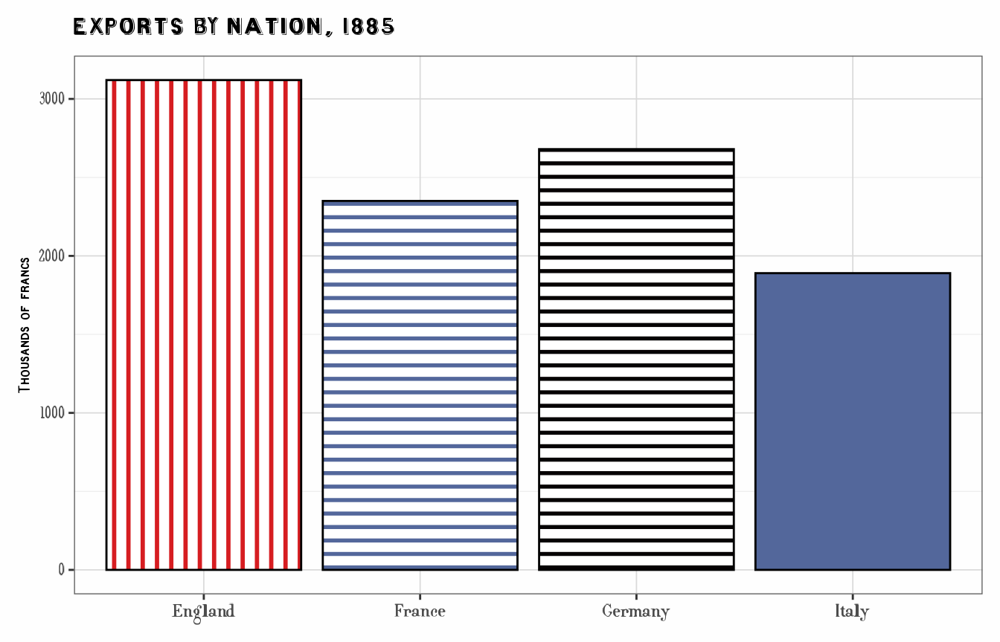
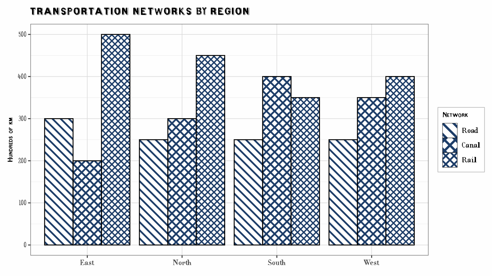
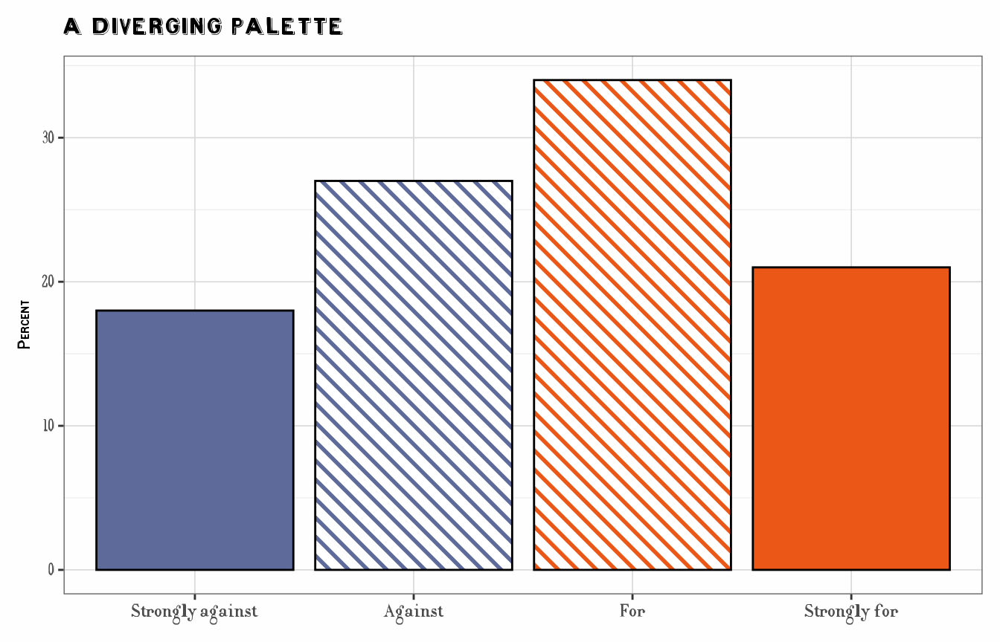
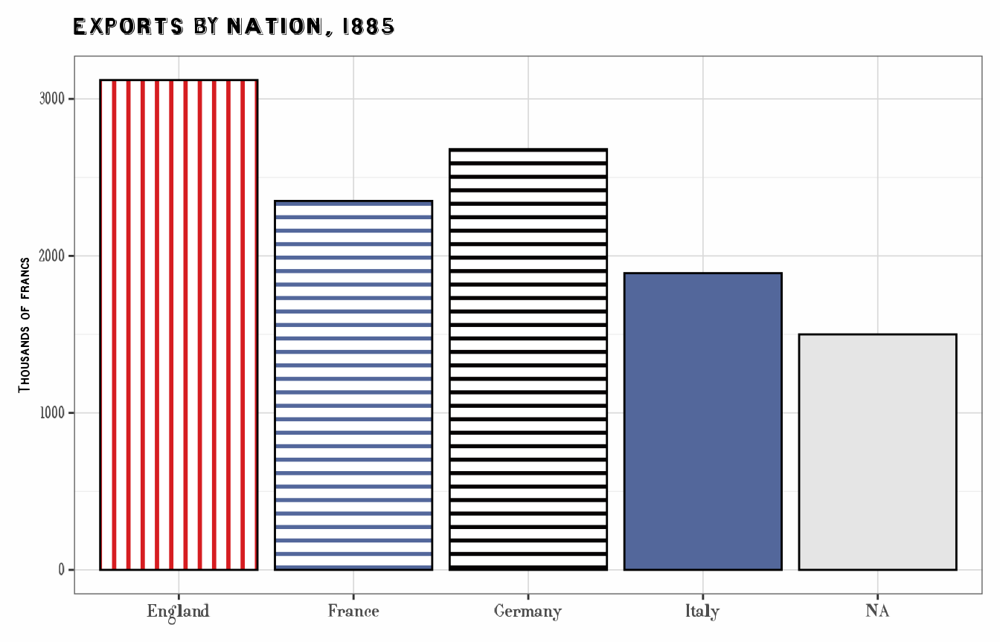
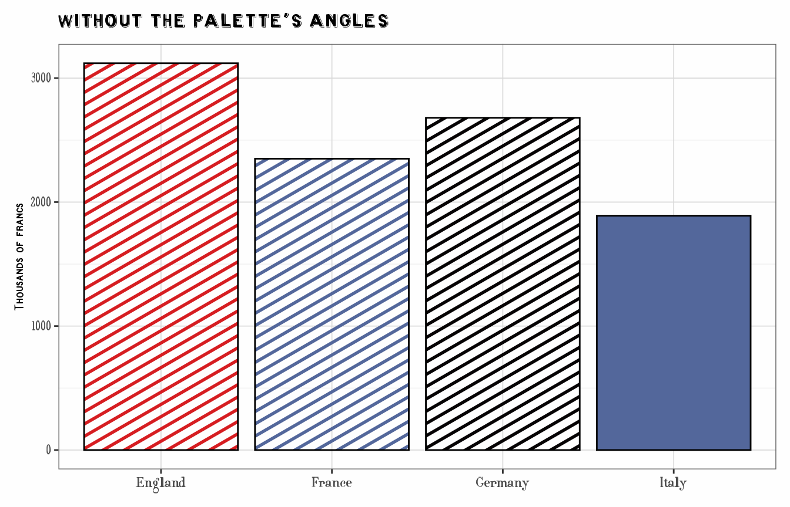

# Combining Colors and Patterns

**Experimental.**
[`scale_cheysson()`](https://friendly.github.io/ggCheysson/reference/scale_cheysson.md)
is new in ggCheysson 1.1.0, and was changed in 1.2.0 to a single scale
using the *swatches* described below; its interface may change again. In
1.2.0,
[`aes_cheysson()`](https://friendly.github.io/ggCheysson/reference/scale_cheysson.md)
is deprecated: it is now the same as `aes(pattern = x)`.

``` r

library(ggCheysson)
library(ggplot2)
library(ggpattern)
```

## Palettes that combine color and hatching

In the *Albums de Statistique Graphique*, a class on a map or a bar in a
chart was rarely distinguished by color alone. Cheysson’s palettes
combine colors with hatching: solid fills, stripes at different angles
and spacings, and crosshatching, sometimes in two colors.

Each element of a palette in `cheysson_patterns` is therefore a small
bundle of properties. Here are the six elements of palette `1886_28`:

``` r

pats <- cheysson_pattern("1886_28")
data.frame(
  pattern       = cheysson_pattern_params(pats, "pattern_type"),
  fill          = cheysson_pattern_params(pats, "fill"),
  pattern_fill  = cheysson_pattern_params(pats, "pattern_fill"),
  pattern_fill2 = cheysson_pattern_params(pats, "pattern_fill2"),
  pattern_angle = cheysson_pattern_params(pats, "pattern_angle")
)
#>   pattern        fill pattern_fill pattern_fill2 pattern_angle
#> 1  stripe transparent      #d61d21       #d61d21            90
#> 2  stripe transparent      #53679b       #53679b             0
#> 3  stripe transparent      #060304       #060304             0
#> 4    none     #53679b      #53679b       #53679b            45
#> 5    none     #d61d21      #d61d21       #d61d21            45
#> 6    none     #060304      #060304       #060304            45
```

- `pattern`: the hatch type, `"none"` for a solid fill
- `fill`: the paper or fill color behind the hatching (`"transparent"`
  for hatching on bare paper)
- `pattern_fill`: the color of the hatch lines
- `pattern_fill2`: the color of a crosshatch’s second set of lines (the
  same as `pattern_fill` except in two-color crosshatches)
- `pattern_angle`: the angle of the lines

## The long way: one mapping and one scale per property

In `ggplot2` with `ggpattern`, each of these properties is a separate
aesthetic. To apply a palette to a variable, each aesthetic needs both a
**mapping** in
[`aes()`](https://ggplot2.tidyverse.org/reference/aes.html) and a
**scale** that supplies its values:

``` r

trade <- data.frame(
  country = c("France", "England", "Germany", "Italy"),
  exports = c(2350, 3120, 2680, 1890)
)

ggplot(trade, aes(country, exports)) +
  geom_col_pattern(
    aes(fill = country, pattern = country, pattern_fill = country,
        pattern_fill2 = country, pattern_angle = country),
    pattern_colour = NA, pattern_density = 0.3, pattern_spacing = 0.025,
    colour = "black"
  ) +
  scale_fill_cheysson_pattern("1886_28") +
  scale_pattern_type_cheysson("1886_28") +
  scale_pattern_fill_cheysson("1886_28") +
  scale_pattern_fill2_cheysson("1886_28") +
  scale_pattern_angle_cheysson("1886_28") +
  labs(title = "Exports by Nation, 1885", x = NULL, y = "Thousands of francs") +
  theme_cheysson() +
  theme(legend.position = "none")
```


## The short way: swatches and `scale_cheysson()`

ggCheysson registers each element of each palette as a `ggpattern`
pattern of its own, a *swatch*, named `"<palette>-<element>"`
(e.g. `"1886_28-1"`). A swatch draws all of the element’s properties
together: its fill or paper color, hatch type, line colors and angle, as
well as its own line spacing and density. So only one aesthetic needs to
be mapped, `pattern`, and `scale_cheysson("1886_28")` is a single scale
that gives each level of `country` one swatch. This draws essentially
the same plot as above (the swatches’ line spacings differ slightly,
following Cheysson’s; see [Line spacing and
density](#line-spacing-and-density)):

``` r

ggplot(trade, aes(country, exports, pattern = country)) +
  geom_col_pattern(colour = "black") +
  scale_cheysson("1886_28") +
  labs(title = "Exports by Nation, 1885", x = NULL, y = "Thousands of francs") +
  theme_cheysson() +
  theme(legend.position = "none")
```



The other pattern aesthetics, such as `pattern_fill` or `pattern_angle`,
aren’t needed, and a swatch ignores them if they are mapped or set. The
exceptions are `pattern_spacing` and `pattern_density`, which change how
close and how thick the lines are; see [Line spacing and
density](#line-spacing-and-density) below.

## Choosing a palette: the swatch atlas

[`show_swatches()`](https://friendly.github.io/ggCheysson/reference/show_swatches.md)
draws every swatch, one row per palette and one column per element, with
the palettes grouped by type. A swatch’s name is its row and column: row
`1886_28`, column 3 is `"1886_28-3"`. `scale_cheysson("1886_28")` uses
that row from left to right, and when the data have fewer levels than
the palette has elements, it picks elements spread across the row (see
[Ordered data](#ordered-data-sequential-and-diverging-palettes)).

``` r

show_swatches()
```


The atlas shows how Cheysson built each kind of palette. In sequential
palettes such as `1888_27` and `1900_28`, the steps are hatchings of
increasing density, ending in a solid color. In grouped palettes such as
`1886_11` and `1886_24`, each color comes as stripes and crosshatching,
or solid and hatched. Category palettes are mostly solid colors. To see
only some palettes, give their names or a type,
e.g. `show_swatches("diverging")`.

## Legends

There is one scale, so there is one legend, and its keys show the full
swatches. Arguments to
[`scale_cheysson()`](https://friendly.github.io/ggCheysson/reference/scale_cheysson.md)
such as `name` and `labels` go to that scale. Here a sequential palette,
`1881_12`, whose three steps are hatchings of increasing density in a
single color, distinguishes three kinds of transport:

``` r

infrastructure <- data.frame(
  region = rep(c("North", "South", "East", "West"), each = 3),
  type   = factor(rep(c("Road", "Canal", "Rail"), 4), levels = c("Road", "Canal", "Rail")),
  length = c(250, 300, 450,  250, 400, 350,  300, 200, 500,  250, 350, 400)
)

ggplot(infrastructure, aes(region, length, pattern = type)) +
  geom_col_pattern(position = "dodge", colour = "black") +
  scale_cheysson("1881_12", name = "Network") +
  labs(title = "Transportation Networks by Region", x = NULL, y = "Hundreds of km") +
  theme_cheysson()
```



## Ordered data: sequential and diverging palettes

Sequential palettes are stored from low to high (light to dark), and
diverging palettes from one extreme through the middle to the other, so
`reverse = TRUE` flips every palette the same way. When the data have
fewer levels than the palette has elements, the scales pick elements
spread over the whole palette, keeping both ends.

Palette `1883_31` is diverging: two hues, each used solid and hatched.
As in Cheysson’s maps, the solid fills mark the extremes and the hatched
versions the milder classes:

``` r

opinion <- data.frame(
  response = factor(c("Strongly against", "Against", "For", "Strongly for"),
                    levels = c("Strongly against", "Against", "For", "Strongly for")),
  percent = c(18, 27, 34, 21)
)

ggplot(opinion, aes(response, percent, pattern = response)) +
  geom_col_pattern(colour = "black") +
  scale_cheysson("1883_31") +
  labs(title = "A Diverging Palette", x = NULL, y = "Percent") +
  theme_cheysson() +
  theme(legend.position = "none")
```



## Missing values

Missing values get the pattern `na.value`, by default `"none"`: no
swatch, so the bar shows the geom’s own `fill`. Since every swatch
covers the geom’s fill, setting `fill` in the geom sets the color for
missing values only:

``` r

trade_na <- rbind(trade, data.frame(country = NA, exports = 1500))

ggplot(trade_na, aes(country, exports, pattern = country)) +
  geom_col_pattern(fill = "grey90", colour = "black") +
  scale_cheysson("1886_28") +
  labs(title = "Exports by Nation, 1885", x = NULL, y = "Thousands of francs") +
  theme_cheysson() +
  theme(legend.position = "none")
```



## Line spacing and density

The swatches of a palette keep the relative line spacings Cheysson used,
measured on his plates: in a sequential palette such as `1888_27` the
hatching gets denser at each step (see the literacy map in
[`vignette("guerry-maps", package = "ggCheysson")`](https://friendly.github.io/ggCheysson/articles/guerry-maps.md)).
A palette’s typical swatch has a spacing of 0.025, and all draw their
lines with a density of 0.3, which suit plots of about this size.

`pattern_spacing` in the geom sets that typical spacing, and the other
swatches keep their proportions to it; `pattern_density` sets the
density. What they mean depends on the version of `ggpattern`:

- **ggpattern 1.4.0 or later**: they replace the defaults, so
  `pattern_spacing = 0.05` gives lines twice as far apart.
- **Earlier versions**: these always supply their own values (0.05 and
  0.2), so the swatches treat a setting as relative to those:
  `pattern_spacing = 0.1` gives lines twice as far apart.

So code that sets them may draw differently when `ggpattern` is updated;
set them only when needed. See
[`?cheysson_swatches`](https://friendly.github.io/ggCheysson/reference/cheysson_swatches.md)
for details, including `pattern_units`.

## Using only some of a palette’s properties

A swatch always applies all of an element’s properties. To use only some
of them, use the individual scales,
[`scale_fill_cheysson_pattern()`](https://friendly.github.io/ggCheysson/reference/scale_fill_cheysson_pattern.md)
and the `scale_pattern_*_cheysson()` family, as in [the long
way](#the-long-way-one-mapping-and-one-scale-per-property) above, and
map only the aesthetics you want. Here the bars keep the palette’s
fills, hatch types and line colors, but not its angles:

``` r

ggplot(trade, aes(country, exports, fill = country, pattern = country,
                  pattern_fill = country)) +
  geom_col_pattern(pattern_colour = NA, pattern_density = 0.3, pattern_spacing = 0.025,
                   colour = "black") +
  scale_fill_cheysson_pattern("1886_28") +
  scale_pattern_type_cheysson("1886_28") +
  scale_pattern_fill_cheysson("1886_28") +
  labs(title = "Without the palette's angles", x = NULL, y = "Thousands of francs") +
  theme_cheysson() +
  theme(legend.position = "none")
```



## What is not included

- Line widths: all swatches use the same density, so a hatching’s
  darkness comes from its spacing alone. A few palettes, such as
  `1891_19`, trade spacing against line width, and draw less faithfully.
- The scales are discrete. For continuous data, cut it into classes
  first, as Cheysson did.
- For plots without patterns
  ([`geom_col()`](https://ggplot2.tidyverse.org/reference/geom_bar.html),
  [`geom_point()`](https://ggplot2.tidyverse.org/reference/geom_point.html),
  …), use
  [`scale_fill_cheysson()`](https://friendly.github.io/ggCheysson/reference/scale_color_cheysson.md)
  and
  [`scale_color_cheysson()`](https://friendly.github.io/ggCheysson/reference/scale_color_cheysson.md),
  which use the palettes’ colors only.
